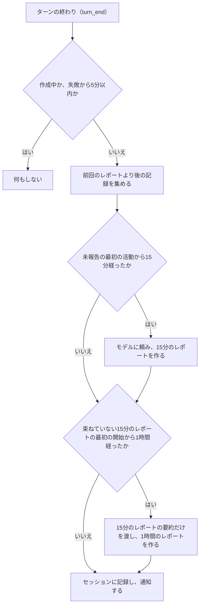

# pi-timeline

長い作業の進み具合を、一定の間隔のレポートとしてセッションに残す pi の拡張機能。`/timeline` で、タスクの状態とレポートをまとめて表示する。

DeepSeek Harness の Timeline プラグイン（`@deepseek-ai/dsh-timeline`）のうち、定期レポートの部分を pi 向けに作り直したもの。タスクの管理は作らず、[`@juicesharp/rpiv-todo`](https://www.npmjs.com/package/@juicesharp/rpiv-todo) の記録を読む。

## 使い方

```
/timeline        タスクとレポートを表示する
/timeline now    今までの分のレポートを作ってから表示する（間隔を待たない）
```

表示の例:

```
タイムライン
タスク 1/3 完了
  ✓ #1 不具合を再現する
      失敗するテストを足した
  ◐ #2 修正する（同期処理を修正中）
  ○ #3 PR を作る

レポート
  15分 10:30–10:45（ツール 7 回）
    ・PR を作った
    ・CI は合格
    未解決: 旧形式を移すか未定
    できること: PR を確認する
  1時間 10:00–10:30  不具合を直した
  15分 10:15–10:30  修正した
```

- 最新の15分のレポートだけ3欄（進捗・未解決・できること）を出し、それより前は1件目だけを新しい順に並べる
- レポートができるたびに、1件目を通知で知らせる（`notify` で切れる）
- タスクの欄は rpiv-todo が入っているときだけ出る。完了したタスクの下の行は、タスクの `description`

## 設定

設定ファイルに、レポートを書かせるモデルを指定する。指定するまでレポートは作らない。

場所は `$PI_TIMELINE_CONFIG`、`$XDG_CONFIG_HOME/pi-timeline/config.json`、`~/.config/pi-timeline/config.json` の順に決まる。

```json
{
  "provider": "<pi に登録してあるプロバイダの名前>",
  "model": "<モデルの ID>"
}
```

| 項目 | 内容 | 既定 |
|---|---|---|
| `provider` / `model` | レポートを書かせるモデル（必須）。`pi --list-models` に出る名前 | なし |
| `enabled` | `false` でレポートを作らない | `true` |
| `intervalMinutes` | 基本のレポートの間隔（1〜1440） | `15` |
| `rollupFactor` | 基本の間隔の何倍で束ねるか（2〜24） | `4`（1時間） |
| `maxInputChars` | 1回のレポートでモデルに渡す記録の文字数の上限。超えた分は次回に回す | `40000` |
| `maxItemChars` | 発言やツールの結果の1件あたりの文字数の上限 | `600` |
| `maxLineChars` | レポートの1行の文字数の上限 | `160` |
| `maxOutputTokens` | モデルの出力の上限 | `2000` |
| `timeoutSeconds` | モデルの応答を待つ時間 | `120` |
| `language` | レポートを書く言語の名前 | `日本語` |
| `focus` | レポートで重く扱う点（指示文に入る） | 何が変わり、目的にどう影響するか |
| `notify` | レポートができたら通知する | `true` |

使えない値は既定値に戻し、`/timeline` の末尾でどの項目かを知らせる。設定を変えたら `/reload` する。

## 仕組み



- **きっかけはターンの終わりだけ**で、タイマーは持たない。作業していない間はモデルを呼ばない。レポートの作成はターンを待たせず、裏で進む
- **モデルに渡すのは差分だけ**。前回のレポートより後の発言・ツールの呼び出し・ツールの結果を1件1行に直し、前回の要約と今のタスクの状態を添える。思考の中身は渡さない
- 差分が `maxInputChars` を超えたら入る分だけでレポートを作り、残りは次のターンの終わりに続きから作る
- **1時間のレポートには元の記録を渡さない**。15分のレポートの要約だけを束ねる
- モデルの返答は JSON で受け取り、件数と長さを確かめる。合わなければ理由を付けて1回だけ直しを頼む
- レポートは `pi-timeline-report` という種類の記録としてセッションに残る。モデルの文脈には入らない。`/tree` で過去に戻ると、その時点までのレポートだけが見える
- 画面の無い実行（`pi -p` や、サブエージェントとして動く子の pi）では何もしない

### レポートの形

| 欄 | 件数 | 内容 |
|---|---|---|
| `progress` | 1〜4 | 1件目は単独で読める要約。2件目からは根拠、限界、決まっている次の一手 |
| `uncertainties` | 0〜2 | 根拠のある、まだ決まっていないこと |
| `userActions` | 0〜2 | 利用者が今、並行してできること |

### モデルの呼び出しの回数

作業が続いている間、15分に1回と、1時間に1回。入力は1回あたり `maxInputChars` 字までで、1時間のレポートは要約4件ほど。返答が決まりに合わなかったときだけ、直しの1回が加わる。

## 知っておくこと

- 最初のレポートは、作業を始めてから15分後の最初のターンの終わりにできる。それより短い作業ではできない。見たいときは `/timeline now` を使う
- 作業の最後の15分に満たない分は、次に作業を再開したときか、`/timeline now` を実行したときにレポートになる
- すでに長く続いているセッションに入れると、過去の記録を `maxInputChars` 字ずつ、ターンの終わりのたびに追いかけてレポートにする
- タスクの記録の形は rpiv-todo 2.15.0 で確かめた。形が合わない記録は読み飛ばし、タスクの欄を出さない

## テスト

```bash
npm ci
npm test         # node --test
npm run check    # tsc
```

pi の型には依存していない（使う部分だけを `src/host.ts` に書いてある）ので、pi が無くてもテストと型の検査ができる。

## 出典

レポートの文体の決まりと JSON の形は、DeepSeek Harness の Timeline（MIT）を元にした。詳しくは [THIRD_PARTY_NOTICES.md](THIRD_PARTY_NOTICES.md)。
