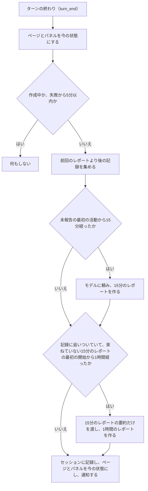

# pi-todo-timeline

タスクの一覧（`todo` ツール）と、一定の間隔の進み具合のレポートを、1か所にまとめて見せる pi の拡張機能。入力欄の上のパネルと、1枚の HTML のページ、`/timeline` で表示する。

DeepSeek Harness の Timeline プラグイン（`@deepseek-ai/dsh-timeline`）の「タスクは常に見える所に、レポートは見に行く所に」という分け方に倣った。`todo` ツールの名前と引数は [`@juicesharp/rpiv-todo`](https://www.npmjs.com/package/@juicesharp/rpiv-todo) と同じにしてあり、置き換えて使える。

## 導入

```bash
pi install git:github.com/MINTY1st/pi-todo-timeline
```

入れたら pi を起動し直すか `/reload` する。レポートを作るには、下の「設定」でモデルを指定する。

`@juicesharp/rpiv-todo` など、`todo` という名前のツールを持つ別の拡張とは一緒に入れられない（同じ名前のツールが2つあると、pi は起動に失敗する）。先にそちらを外すか（`pi remove npm:@juicesharp/rpiv-todo`）、こちらの設定で `todoTool` を `false` にする。rpiv-todo が残したタスクの記録は、そのまま読んで続きから使える。

## 使い方

```
/timeline        タスクとレポートを表示する
/timeline now    今までの分のレポートを作ってから表示する（間隔を待たない）
```

### タスク（todo ツール）

モデルが `todo` ツールでタスクを作り、進めるたびに更新する。人が直接操作するコマンドは無い。

| 操作 | 内容 |
|---|---|
| `create` | 1件、または `tasks` でまとめて作る。番号は1から順に振る |
| `update` | 状態（`pending` → `in_progress` → `completed`）、件名、説明、今の作業（`activeForm`）、待つ相手を変える |
| `list` / `get` | 一覧と、1件の詳細 |
| `delete` | 消した印を付ける（番号は使い回さない） |
| `clear` | 全部消して、番号を1から振り直す |

- 完了にするときは、何をしてどうなったかを `description` に1行で書くよう、モデルへの指示に入れてある。パネルとページの「結果」はこれを出している
- 完了したタスクは消さずに残す。完了から戻すことはできない（消すことだけできる）
- 状態は操作のたびにセッションに記録する。`/reload`、圧縮、`/tree` での移動の後も、その時点の記録から読み直す
- 操作の直後に、パネルとページを更新する
- 画面の無い実行（`pi -p` や、サブエージェントとして動く子の pi）でもツールは使える。タスクはセッションごとに別

### パネル

画面の下に `timeline` と `reports` のボタンが出る（Pi Web の場合。押したほうだけが、入力欄の上に色つきの文字で開く。TUI では、入力欄の上に両方がそのまま出る）。

`timeline` はタスク。

```
進捗 ███████░░░░░░░░░░░░░ 33%  1/3 完了 · 経過 45分
今   #2 修正する（同期処理を修正中）

✓ #1 不具合を再現する
    失敗するテストを足した
◐ #2 修正する
○ #3 PR を作る
```

`reports` はレポート。

```
15分 10:45–11:00  ツール 7 回
  ・PR を作った
  ・CI は合格
  未解決 旧形式を移すか未定
  できること PR を確認する
15分 10:30–10:45  テストを足した
1時間 10:00–10:30  不具合を直した

ページ /work/.pi/timeline/1101-1000-01a1d8af.html
```

- ターンが終わるたび、レポートができるたびに更新する。中身が変わらなければ送り直さない（Pi Web は、中身が変わったパネルのボタンを光らせる）
- タスクは終わっていないものを優先して10件まで並べ、省いた分は件数だけ示す（`panelMaxTasks`）。完了の結果は80字で切る
- レポートは最新の15分のものを3欄で、それより前を5件まで1行で出す。全部を見るときはページを開く
- タスクが無い間は `timeline` を、レポートが無い間は `reports` を出さない。セッションを閉じると両方消す
- タスク名やレポートの文に混ざった制御文字は取り除く

### パネルの高さ（Pi Web）

Pi Web は、拡張のパネルの高さを 144px（画面が低ければ画面の高さの18%）までに決めていて、はみ出た分は縦にスクロールする。拡張の側からは変えられないので、Pi Web の CSS に上書きを足すコマンドを同梱している。

```bash
# 足す（高さの上限を、設定の panelMaxHeightPercent にする。既定は画面の高さの 50%）
node ~/.pi/agent/git/github.com/MINTY1st/pi-todo-timeline/src/web-css-cli.ts apply
# 外す
node ~/.pi/agent/git/github.com/MINTY1st/pi-todo-timeline/src/web-css-cli.ts remove
```

実行したら、ブラウザでキャッシュを使わない再読み込み（Ctrl+Shift+R）をする。Pi Web の再起動は要らない。

- Pi Web の配布物のうち、パネルの規則（`.extension-widget-panels`）を含む CSS のファイルの末尾に、目印つきで1行足すだけ。ほかのファイルには触らない。何度実行しても同じ結果になり、`remove` で元の中身に戻る
- 上限なので、中身が短ければパネルもその高さになる
- 設定の値を変えたら、もう一度 `apply` する
- Pi Web を更新すると消える。systemd で動かしているなら、起動の前に当て直すようにしておける（先頭の `-` は、失敗しても起動を止めない指定）

  ```ini
  [Service]
  ExecStartPre=-/usr/bin/env node %h/.pi/agent/git/github.com/MINTY1st/pi-todo-timeline/src/web-css-cli.ts apply
  ```

- Pi Web の場所は、`--dir`、環境変数 `PI_WEB_DIR` の順に決める。どちらも無ければ、npm が全体に入れた場所を探す（実行している node の隣の `lib/node_modules`、node の隣の `node_modules`、Windows の `%APPDATA%\npm\node_modules`）。見つからなければ、探した場所を並べて終わる
- Windows では、上のコマンドの `~/.pi/agent` を `%USERPROFILE%\.pi\agent` に読み替える。起動の前に当て直す仕組みは用意していないので、Pi Web を更新したら手で `apply` する
- Pi Web がパネルの作りを変えると効かなくなる。そのときは「含む CSS がありません」と出て失敗する

### ページ

タスクとレポートを、セッションごとに1枚の HTML に書き出す。置き場は `<作業ディレクトリ>/.pi/timeline/<開始の月日>-<時分>-<セッション ID の先頭8桁>.html`。`/timeline` を実行すると、末尾に場所が出る。

[Pi Web](https://github.com/agegr/pi-web) では、ファイルの一覧からこのファイルを開いてプレビューに切り替えると、会話の横に表示される。ターンが終わるたび、レポートができるたびに書き直すので、開いたままにしておけば最新の状態が見える。

- **タスク**: 完了した割合のバー、完了数、最初の活動からの経過、今の作業（無ければ次の作業）、各タスクの結果
- **レポート**: 新しい順。15分と1時間を色で分け、未解決とできることを札で示す。1時間のレポートは、含む15分のレポートを折りたたんで持つ

ページは外の資源を読み込まず、1枚で完結している。作業ディレクトリが git の作業ツリーなら、置き場を `.git/info/exclude` に足して追跡の対象から外す。`.git` がファイルの作業ツリー（`git worktree` で作ったもの）と、作業ディレクトリがリポジトリの途中の階層にあるときは外さないので、必要なら `.gitignore` に足す。

### 文字での表示

`/timeline` は、同じ内容を文字でも通知に出す。表示の例:

```
タイムライン
タスク 1/3 完了
  ✓ #1 不具合を再現する
      失敗するテストを足した
  ◐ #2 修正する（同期処理を修正中）
  ○ #3 PR を作る

レポート
  15分 10:30–10:45（ツール 7 回）
    ・PR を作った
    ・CI は合格
    未解決: 旧形式を移すか未定
    できること: PR を確認する
  1時間 10:00–10:30  不具合を直した
  15分 10:15–10:30  修正した
```

- 最新の15分のレポートだけ3欄（進捗・未解決・できること）を出し、それより前は1件目だけを新しい順に並べる
- レポートができるたびに、1件目を通知で知らせる（`notify` で切れる）
- 完了したタスクの下の行は、タスクの `description`（完了のときに書かれた結果）

## 設定

設定ファイルに、レポートを書かせるモデルを指定する。指定するまでレポートは作らない。

場所は `$PI_TODO_TIMELINE_CONFIG`、`$XDG_CONFIG_HOME/pi-todo-timeline/config.json`、`~/.config/pi-todo-timeline/config.json` の順に決まる。Windows でも同じで、`~` は `C:\Users\<名前>` になる。

```json
{
  "provider": "<pi に登録してあるプロバイダの名前>",
  "model": "<モデルの ID>"
}
```

| 項目 | 内容 | 既定 |
|---|---|---|
| `provider` / `model` | レポートを書かせるモデル（必須）。`pi --list-models` に出る名前 | なし |
| `reasoning` | モデルに頼む思考の強さ（pi の thinking level。`low` など）。思考を切れないモデルでは指定が要る | 指定しない |
| `enabled` | `false` でレポートを作らない | `true` |
| `intervalMinutes` | 基本のレポートの間隔（1〜1440） | `15` |
| `rollupFactor` | 基本の間隔の何倍で束ねるか（2〜24） | `4`（1時間） |
| `maxInputChars` | 1回のレポートでモデルに渡す記録の文字数の上限。超えた分は次回に回す | `40000` |
| `maxItemChars` | 発言やツールの結果の1件あたりの文字数の上限 | `600` |
| `maxLineChars` | レポートの1行の文字数の上限 | `160` |
| `maxOutputTokens` | モデルの出力の上限。思考の分も数えるモデルがあるので、要約の長さより多めにしてある | `4000` |
| `timeoutSeconds` | モデルの応答を待つ時間 | `120` |
| `language` | レポートを書く言語の名前 | `日本語` |
| `focus` | レポートで重く扱う点（指示文に入る） | 何が変わり、目的にどう影響するか |
| `notify` | レポートができたら通知する | `true` |
| `todoTool` | `todo` ツールを登録する。別の拡張の `todo` と一緒に使うときは `false` | `true` |
| `panel` | 入力欄の上にパネルを出す | `true` |
| `panelMaxTasks` | パネルに並べるタスクの上限（1〜50） | `10` |
| `panelMaxHeightPercent` | Pi Web のパネルの高さの上限。画面の高さに対する %（10〜90）。上のコマンドが使う | `50` |
| `page` | HTML のページを書き出す | `true` |
| `pageDirectory` | ページの置き場。相対パスなら作業ディレクトリから | `.pi/timeline` |

使えない値は既定値に戻し、`/timeline` の末尾でどの項目かを知らせる。設定を変えたら `/reload` する。

## 仕組み



- **きっかけはターンの終わりだけ**で、タイマーは持たない。作業していない間はモデルを呼ばない。レポートの作成はターンを待たせず、裏で進む
- **モデルに渡すのは差分だけ**。前回のレポートより後の発言・ツールの呼び出し・ツールの結果を1件1行に直し、前回の要約と今のタスクの状態を添える。思考の中身は渡さない
- 差分が `maxInputChars` を超えたら入る分だけでレポートを作り、残りは次のターンの終わりに続きから作る。追いつくまでは束ねない
- 添えるタスクの状態は、そのレポートが覆う区間の終わりの時点のもの。過去の区間のレポートに、後の状態は混ぜない
- **1時間のレポートには元の記録を渡さない**。15分のレポートの要約だけを束ねる
- モデルの返答は JSON で受け取り、件数と長さを確かめる。合わなければ理由を付けて1回だけ直しを頼む。返答に文が無いとき、出力の上限で途中で切れたとき、JSON として読めないときは、直しを頼まず失敗として扱う（元の中身が無いのに直させると、中身の無いレポートができるため）
- レポートは `pi-timeline-report` という種類の記録としてセッションに残る（拡張の名前を変える前の記録も読めるよう、この名前は変えていない）。モデルの文脈には入らない。`/tree` で過去に戻ると、その時点までのレポートだけが見える
- 画面の無い実行（`pi -p` や、サブエージェントとして動く子の pi）では何もしない

### レポートの形

| 欄 | 件数 | 内容 |
|---|---|---|
| `progress` | 1〜4 | 1件目は単独で読める要約。2件目からは根拠、限界、決まっている次の一手 |
| `uncertainties` | 0〜2 | 根拠のある、まだ決まっていないこと |
| `userActions` | 0〜2 | 利用者が今、並行してできること |

### モデルの呼び出しの回数

作業が続いている間、15分に1回と、1時間に1回。入力は1回あたり `maxInputChars` 字までで、1時間のレポートは要約4件ほど。返答が決まりに合わなかったときだけ、直しの1回が加わる。

## 知っておくこと

- 最初のレポートは、作業を始めてから15分後の最初のターンの終わりにできる。それより短い作業ではできない。見たいときは `/timeline now` を使う
- 作業の最後の15分に満たない分は、次に作業を再開したときか、`/timeline now` を実行したときにレポートになる
- Claude の新しいモデルのように思考を切れないモデルは、`reasoning` を書かないと失敗する（`/timeline` の末尾に理由が出る）
- すでに長く続いているセッションに入れると、過去の記録を `maxInputChars` 字ずつ、ターンの終わりのたびに追いかけてレポートにする
- ページはセッションごとに1ファイルずつ増える。古いものは自動では消さない
- ページの「タスク」「レポート」のタブは、ファイルの更新で描き直されても同じタブを開くよう `window.name` に覚える。プレビューの作りによっては、更新のたびに「タスク」に戻る
- 「モデルの返答が出力の上限に達して途中で切れました」が続くときは、`maxOutputTokens` を上げるか、`reasoning` を下げる
- タスクの記録は `pi-todo-timeline-tasks` という種類でセッションに残る。rpiv-todo の記録（`rpiv-todo-state`、2.15.0 で確かめた）も読める。形が合わない記録は読み飛ばす
- rpiv-todo にある担当（`owner`）と任意の付帯情報（`metadata`）、待つ相手の循環の検査、`/todos` コマンドは持っていない

## 動かして確かめた環境

| 環境 | 確かめたこと |
|---|---|
| Linux（WSL2）、pi 1.5.0 / 1.5.2、Node 24、Pi Web 0.15.0 | すべての機能。実際のモデルでの `todo` の操作とレポートの作成を含む |
| Windows 11、pi 1.5.2、Node 24 | テストの全件、拡張の読み込み、パネル、ページの書き出し、`.git/info/exclude` への追記、設定の場所、高さのコマンド |

Windows では、モデルを呼ぶ部分（`todo` の操作、レポートの作成）と、Pi Web での見え方は動かしていない。この部分は OS に依らない作りで、テストは Windows でも全件通る。

## テスト

```bash
npm ci
npm test         # node --test
npm run check    # tsc
```

pi の型には依存していない（使う部分だけを `src/host.ts` に書いてある）ので、pi が無くてもテストと型の検査ができる。

## 出典

レポートの文体の決まりと JSON の形は、DeepSeek Harness の Timeline（MIT）を元にした。`todo` ツールの操作・引数・応答の文・状態の移り変わりの決まりは、@juicesharp/rpiv-todo（MIT）に合わせた。詳しくは [THIRD_PARTY_NOTICES.md](THIRD_PARTY_NOTICES.md)。
