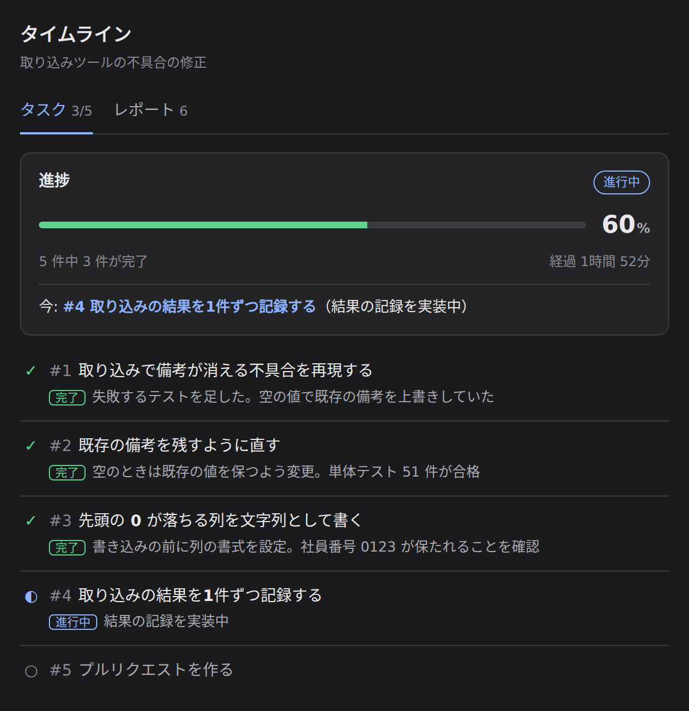
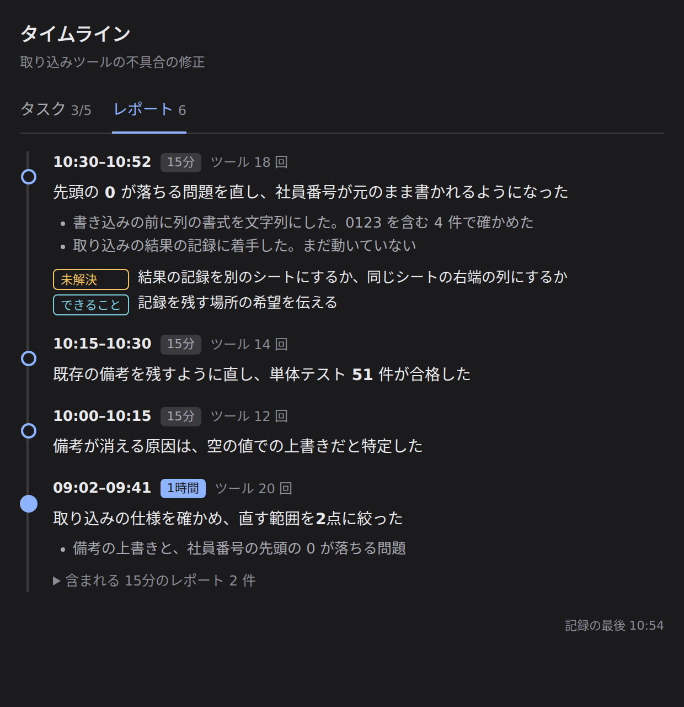

# pi-todo-timeline

[](https://www.npmjs.com/package/@minty1st/pi-todo-timeline)
[](LICENSE)


A [Pi](https://pi.dev) extension that keeps a task list and timed progress reports in view during long agent sessions.

- **Tasks**: the model plans and tracks work with a `todo` tool. Completed tasks stay visible, each with a one-line result.
- **Reports**: while work continues, a separate model call summarizes every 15 minutes what changed, what is undecided, and what you can do in parallel. Hourly reports combine them.
- **Views**: two panels above the editor, one HTML page per session, and the `/timeline` command.

Tasks stay where you always see them and reports where you go to read them, as in the Timeline plugin of DeepSeek Harness.

 

The page for one session, as the `timeline` and `reports` buttons open it in Pi Web. The panels show the same content as colored text.

## Requirements

- Node.js 24.21 or later and Pi 1.5 or later.
- Linux or Windows. Tested on WSL2 and on Windows 11 with Pi 1.5.2; macOS is untested.
- A model for reports is optional. Without one, tasks, panels, and the page still work.
- [Pi Web](https://github.com/agegr/pi-web) is optional. It shows each panel behind a button and previews the page beside the chat, or in a popup once the bundled command is applied. Pi's terminal UI shows both panels above the editor at once; that view is untested.
- The interface text is Japanese. Reports are written in Japanese by default; `language` changes that.

## Install

```sh
pi install npm:@minty1st/pi-todo-timeline
```

Or install the latest source with `pi install git:github.com/MINTY1st/pi-todo-timeline`. Restart Pi or run `/reload` afterwards.

Pi fails to start when two extensions register a tool with the same name. Remove any other extension that registers a tool named `todo`, or set `todoTool` to `false`.

## Usage

Tasks need no setup. Ask for work with several steps and the model creates tasks, marks one in progress, and records a one-line result when it completes each one. The `timeline` panel updates after every change.

To get reports, name a model in `~/.config/pi-todo-timeline/config.json`:

```json
{
  "provider": "<a provider configured in Pi>",
  "model": "<model id>"
}
```

The first report appears after 15 minutes of work, at the end of a turn. Reports are stored in the session and never enter the model's context.

```
/timeline        Show tasks and reports as text, and the path of the page
/timeline now    Create a report for the work so far, then show them
```

The page is written to `<working directory>/.pi/timeline/` after each turn. Open it in Pi Web's file preview to keep it beside the chat; it refreshes when the file changes. With the popup below, the `timeline` and `reports` buttons open it directly.

## Configuration

The file is `$PI_TODO_TIMELINE_CONFIG`, else `$XDG_CONFIG_HOME/pi-todo-timeline/config.json`, else `~/.config/pi-todo-timeline/config.json` (`C:\Users\<name>\.config\...` on Windows). Run `/reload` after editing it. Invalid values fall back to the default and are listed by `/timeline`.

| Setting | Default | Description |
|---|---|---|
| `provider`, `model` | Unset | Model that writes reports. No reports are created while unset. |
| `reasoning` | Unset | Thinking level for report calls. Required for models that cannot turn thinking off. |
| `enabled` | `true` | `false` stops report creation. |
| `intervalMinutes` | `15` | Interval of base reports. |
| `rollupFactor` | `4` | Base reports are combined after this many intervals. |
| `maxInputChars` | `40000` | Session text sent per report. The rest is carried to the next report. |
| `language` | `日本語` | Language of reports and task results, as named in the instructions. |
| `notify` | `true` | Notify when a report is created. |
| `todoTool` | `true` | Register the `todo` tool. |
| `panel` | `true` | Show the panels. `panelMaxTasks` (`10`) limits the listed tasks. |
| `page` | `true` | Write the page. `pageDirectory` (`.pi/timeline`) sets where. |
| `webPopup` | `true` | Let the command below add the popup to Pi Web. |
| `panelMaxHeightPercent` | `50` | Panel height limit, in percent of the window height, set by the command below. |

Also available: `maxItemChars`, `maxLineChars`, `maxOutputTokens`, `timeoutSeconds`, and `focus`; see [src/config.ts](src/config.ts).

### Popup and panel height in Pi Web

Pi Web draws extension panels as colored text and limits them to 144px. A bundled command changes both by appending marked blocks to Pi Web's own files, and removes them again:

- a script that opens the page in a popup when you click the `timeline` or `reports` button, in the colors of Pi Web's current theme;
- a CSS rule that raises the panel height limit.

```sh
node ~/.pi/agent/git/github.com/MINTY1st/pi-todo-timeline/src/pi-web-cli.ts apply
node ~/.pi/agent/git/github.com/MINTY1st/pi-todo-timeline/src/pi-web-cli.ts remove
```

Reload the browser without cache afterwards. Click the same button again, or ×, to close the popup; Shift-click opens the text panel instead. The popup does not use Esc, which stops the running turn in Pi Web. `webPopup: false` leaves the script out.

Updating Pi Web removes both blocks, so apply them again. The command runs from a git install or a source checkout only; Node does not execute TypeScript files under `node_modules`, so an npm install cannot run it. Pi Web is located by `--dir`, then `PI_WEB_DIR`, then npm's global directories.

## Limitations

- Reports send session text (messages, tool calls, and clipped tool results) to the configured model. Choose a provider you may send that work to.
- A reply that is cut off or is not valid JSON is discarded, and the report is retried at a later turn. A reply that only breaks the size rules is repaired once.
- Work shorter than the interval produces no report until you resume or run `/timeline now`.
- A completed task cannot be reopened; it can only be deleted. Dependency cycles are not checked.
- The Pi Web command is not available from an npm install. The popup relies on Pi Web's page structure and file API, checked with Pi Web 0.15.0; if they change, the buttons open the text panels as before.
- The popup looks for the page in `.pi/timeline` under the session's working directory, so it does not find a custom `pageDirectory`.
- Pages are written per session and never deleted. In a git working tree the directory is added to `.git/info/exclude`, except in worktrees and subdirectories of a repository.
- On Windows, model calls and the Pi Web views have not been run; unit tests, loading, panels, the page, and the height command have.

## Development

```sh
npm ci
npm test
npm run check
npm pack --dry-run
```

Tests use a fake Pi host and a fake model; they need no Pi installation. [The CI workflow](.github/workflows/ci.yml) runs `npm ci --ignore-scripts`, `npm test`, and `npm run check` on Node 24.22.2, on Linux and Windows, for every pull request and every push to `main`.

## Publishing

An owner-pushed `vX.Y.Z` tag triggers [the publishing workflow](.github/workflows/publish.yml).
The tagged commit must be in `main`, and the tag, manifest, and lockfile versions must match.
Tests and type checks run without publishing credentials; a separate job publishes the verified tarball.
After the package is published, a third job creates the GitHub Release for the tag with generated notes.

One-time npm setup: npm cannot publish the first version of a package through Trusted Publishing, so publish it once manually.
Then, in the package's **Settings → Trusted Publisher**, select GitHub Actions, set the owner and repository to this repository,
and enter `publish.yml` as the workflow filename. Leave the environment name empty. No npm token or GitHub secret is needed afterwards.

Only stable versions are supported. Existing npm versions cannot be overwritten.

## Credits and license

- [deepseek-ai/deepseek-harness](https://github.com/deepseek-ai/deepseek-harness), Timeline plugin — the report format and writing rules, and the idea of timed reports that roll up.

Licensed under [MIT](LICENSE). See [third-party notices](THIRD_PARTY_NOTICES.md) for the notices of the works this package draws on.
